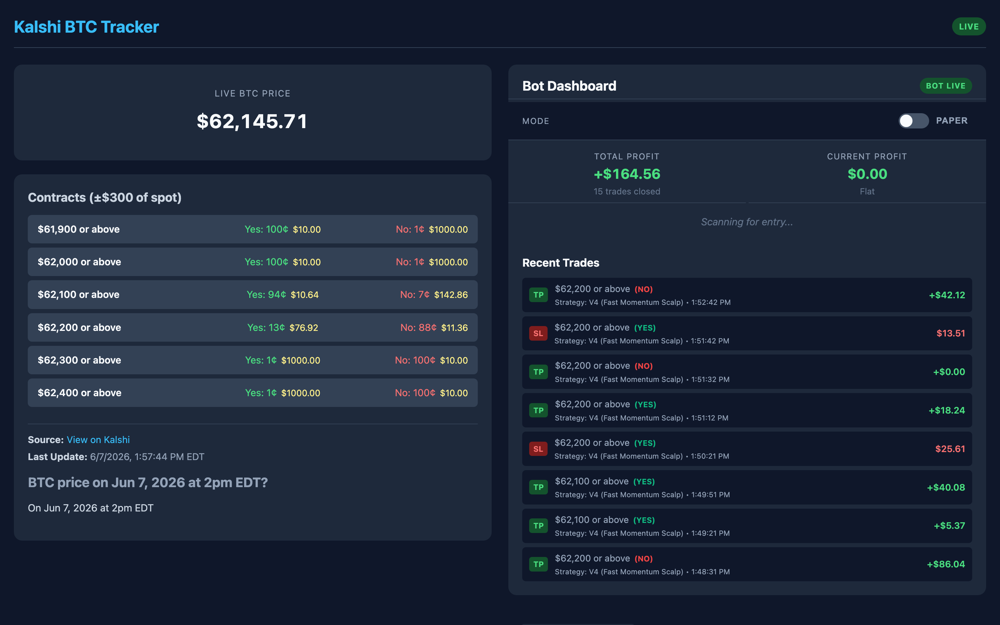
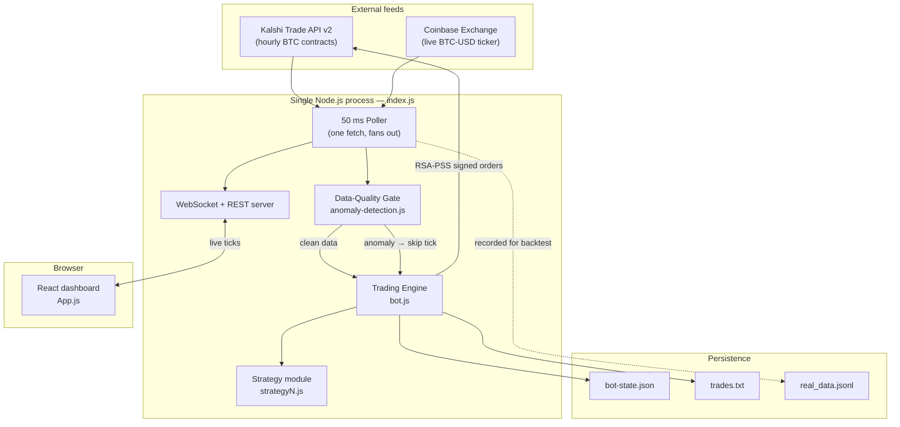
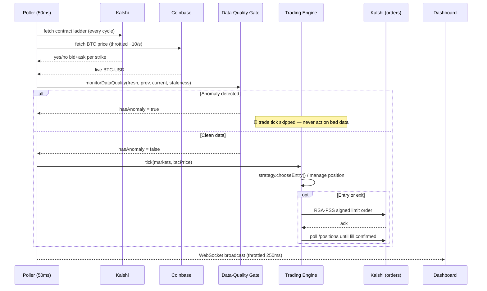

# Kalshi BTC — Real-Time Event-Contract Trading & Data-Quality Engine

> A low-latency, single-process system that ingests live market data from **Kalshi** and **Coinbase**, monitors it for quality anomalies, executes a configurable trading strategy with **fill-confirmed** order management, and streams everything to a live React dashboard — backed by a deterministic backtesting harness for offline strategy research.

<p align="left">
  
  
  
  
  
</p>

---

## Dashboard

A zero-build React dashboard streams the live BTC price, the Kalshi contract ladder (filtered to ±$300 of spot), and the bot's live P&L, open position, and trade history over a WebSocket.



---

## Why this project exists

Kalshi lists hourly binary contracts on *"Will BTC be ≥ $X at the top of the hour?"*. Pricing them well requires three things at once, in real time:

1. **Clean, trustworthy market data** — a single bad tick or a coverage gap can poison a trade decision.
2. **Disciplined execution** — a limit order that *rests unfilled* must never be mistaken for a filled position.
3. **Rigorous offline evaluation** — no strategy touches real money until it has been replayed against recorded history.

This repo is a working, end-to-end implementation of all three. It is as much a **data-engineering and data-quality** project as a trading one: the most interesting parts are the single-poll ingestion architecture, the anomaly-detection gate that sits in front of execution, and the time-travelling backtester.

### What it demonstrates

| Area | In this codebase |
|---|---|
| **Real-time data ingestion** | One 50 ms poll fans out to Kalshi + Coinbase; each external API is hit exactly once per cycle. |
| **Data quality / anomaly detection** | Coverage-gap, feed-staleness, market-rollover, and rolling-window **z-score** drift checks that *gate* execution. |
| **Time-series analysis** | Rolling-window statistics (mean / std / z-score) over a live price-delta stream. |
| **Systems engineering** | Single-process design, exponential backoff, throttling, WebSocket fan-out, graceful hourly restart. |
| **Quant research tooling** | A deterministic backtester plus a suite of parameter-sweep scripts for strategy evaluation. |
| **Secure API integration** | RSA-PSS request signing against the Kalshi Trade API v2; secrets kept out of source. |

---

## System architecture



**Design principle — one poll feeds everything.** A naive build would run the trader and the dashboard as separate processes, each polling Kalshi independently and doubling the API load. Here a single 50 ms poll fetches the data once and fans it out to the data-quality gate, the trading engine, and the dashboard broadcast — so each external API is hit exactly once per cycle.

---

## End-to-end data flow (one poll cycle)



---

## Data quality & anomaly detection

The heart of the project, and the layer that sits **in front of** every trade decision ([`anomaly-detection.js`](backend/anomaly-detection.js)). Every poll cycle, market data is screened by `monitorDataQuality()` *before* it can reach the trading engine. If anything looks wrong, the engine tick is skipped — the bot never acts on bad data.

| Check | What it catches | How |
|---|---|---|
| **Coverage gap** | The price feed never produced a usable value, or the Kalshi market list came back empty. | Tests the *last known-good* price (not a single throttled fetch) and the market array length. |
| **Feed staleness** | A sustained Coinbase outage — the last good tick is older than 2 s. | Compares `now` against the timestamp of the last successful fetch. |
| **Market rollover / illiquidity** | The new hourly contract has been listed but market makers haven't posted prices yet (empty books in the first minutes). | At minute ≤ 2, requires at least one valid `(0,1)` ask before allowing trades. |
| **Time-series drift (z-score)** | A single anomalous BTC tick — a feed glitch or bad print. | Maintains a rolling 60-reading window of price deltas; flags any move beyond **3σ** of the recent mean. |

> **A subtle but important detail:** the z-score window is fed *only* on cycles where a genuinely new price arrived. Because Coinbase is throttled, most 50 ms cycles have no fresh tick — feeding those in as zero-deltas would collapse the standard deviation and silently disable the detector. Getting the throttle/window interaction right is exactly the kind of data-quality nuance this project is about.

This mirrors, in miniature, what a production data-quality pipeline does: **detect coverage drops, missing values, and statistical drift, then gate downstream consumers on data health.**

---

## Trading strategies

Strategy logic is fully decoupled from execution — each module is pure decision logic exposing `chooseEntry(markets)` and returns `{ market, side, ask }` or `null`. The engine runs whichever module(s) are wired in, so strategies are hot-swappable and independently backtestable.

| Variant | Idea |
|---|---|
| **V1 — Volatility Scalping** | Trade contracts near the 50% coin-flip band to harvest short-term price swings. |
| **V2 — Favorite** | Buy the side the market already prices as a strong favorite (65–78% implied), betting it keeps drifting toward resolution. |
| **V3 — Momentum** | Track BTC over a ~5 min rolling window; only buy YES on uptrends, NO on downtrends. |
| **V4 — Fast Momentum Scalp** | A micro-window (~2 s) breakout version of V3 for fast moves. |
| **V5 — Fair-Value / Statistical Edge** | Compute a contract's *fair* probability from BTC's distance-to-strike and volatility, and trade only when the market price diverges from fair value. |

---

## Backtesting & research harness

No strategy touches capital before it has been replayed against recorded history.

- **[`fetch-history.js`](backend/fetch-history.js)** pulls days of hourly Kalshi order books + Coinbase candles into a per-minute `real_data.jsonl` stream, appending a synthetic *settled* tick at each contract's close so positions held to expiry resolve at true $1/$0 outcomes.
- **[`backtester.js`](backend/backtester.js)** replays that stream through the real strategy modules. It **mocks the global clock** ("time travel") so each strategy's rolling windows and expiry math behave exactly as they do live — a deterministic, reproducible evaluation.
- A suite of **parameter-sweep scripts** (`sweep-trailing.js`, `sweep-winrate.js`, `sweep-time-buckets.js`, `sweep-hold-vs-tp.js`, …) grid-searches take-profit / stop-loss / timing parameters to study their effect on win rate and P&L.

### Sample output — in-sample backtest over 11,633 recorded snapshots

```
=== REAL-DATA BACKTEST SUMMARY (11,633 Ticks Analyzed) ===
┌──────────────────────────────────────┬────────┬──────┬────────┬──────────┬────────────┐
│ Strategy                             │ Trades │ Wins │ Losses │ Win Rate │ PnL        │
├──────────────────────────────────────┼────────┼──────┼────────┼──────────┼────────────┤
│ V1 (Volatility Scalping)             │ 754    │ 373  │ 347    │ 49.5%    │ $-373.54   │
│ V2 (Favorite)                        │ 421    │ 244  │ 144    │ 58.0%    │ $-95.10    │
│ V3 (Momentum)                        │ 270    │ 149  │ 94     │ 55.2%    │ $-105.29   │
│ V5 (Fair-Value / Statistical Edge)   │ 48     │ 27   │ 15     │ 56.3%    │ $-13.14    │
└──────────────────────────────────────┴────────┴──────┴────────┴──────────┴────────────┘
```

> **Read this honestly:** these are *in-sample* results under a fixed exit configuration, and most naive variants are **net-negative after the bid/ask spread** despite >50% win rates — a textbook reminder that hit-rate ≠ profitability once costs are paid. That is precisely why the harness exists: **to surface unprofitable ideas offline, before risking a cent.** Strong win rates with negative P&L point straight at the spread/exit asymmetry as the thing to fix next.

---

## Execution: confirmed fills, not optimistic ones

The most production-minded part of the engine ([`bot.js`](backend/bot.js)). A Kalshi limit order can be *accepted yet rest unfilled* if the touch moves. The engine therefore never assumes a fill from the order acknowledgment:

- **Entry** places a limit at the ask, then reads the **actual position delta** from `/portfolio/positions` to learn how many contracts were truly bought, cancelling any unfilled remainder.
- **Exit** crosses the book with an aggressive limit to guarantee a fill, then confirms the position dropped to zero; partial exits book realized P&L and retry the remainder on the next tick.
- **Cooldowns** after a stop-loss prevent re-entry "death loops."
- **Paper mode** short-circuits order placement and simulates fills, so the entire system can run end-to-end with zero financial risk.

---

## Tech stack

- **Runtime:** Node.js 22 (native `fetch`, `crypto`)
- **Server:** Express (REST) + `ws` (WebSocket fan-out)
- **Auth:** RSA-PSS request signing (`crypto`) against Kalshi Trade API v2
- **Frontend:** React 18 via CDN + in-browser Babel — **zero build step**, served statically
- **Data sources:** Kalshi Trade API v2, Coinbase Exchange ticker
- **Persistence:** flat-file JSON / JSONL (state, trade log, recorded history)

---

## Project structure

```
kalshi2/
├── backend/
│   ├── index.js              # Single process: 50ms poller + REST + WebSocket server
│   ├── bot.js                # Trading engine: auth, sizing, confirmed fills, P&L, state
│   ├── anomaly-detection.js  # Data-quality gate: coverage, staleness, rollover, z-score drift
│   ├── strategy*.js          # Pure, hot-swappable strategy modules (V1–V6)
│   ├── backtester.js         # Deterministic "time-travel" replay over recorded data
│   ├── fetch-history.js      # Builds real_data.jsonl from Kalshi + Coinbase history
│   ├── sweep-*.js            # Parameter-sweep research scripts
│   └── run.sh                # Launch loop with graceful hourly restart
├── frontend/
│   ├── index.html            # CDN React + Babel
│   ├── App.js                # Dashboard: live price, ladder, bot panel, trade history
│   └── style.css
└── docs/screenshots/
```

---

## Getting started

### Prerequisites
- Node.js ≥ 18 (developed on 22)
- *(Optional, for live/paper trading against your own account)* a Kalshi API key + RSA private key

### Install
```bash
cd backend
npm install
```

### Configure (optional — only needed to connect an account)
Create `backend/.env`:
```bash
KALSHI_API_KEY_ID=your-key-id
# place your RSA private key at backend/kalshi-private-key.pem
```
> Secrets are **git-ignored** and never committed. Without credentials the system still runs and reads public market data.

### Run
```bash
npm start                 # http://localhost:4000   (one hour, then self-exits)
./run.sh                  # continuous: auto-relaunches each hour
```

### Backtest
```bash
DAYS=7 node fetch-history.js   # download recent history → past_trades/real_data.jsonl
node backtester.js             # replay all strategies, print the P&L table
```

---

## Safety & trading mode

The engine has two modes, set by `mode` in [`backend/bot.js`](backend/bot.js) and toggleable live from the dashboard:

- **`paper`** *(default here)* — connects to real market data but **simulates** all orders. No money moves.
- **`live`** — places **real orders with real funds** on your Kalshi account.

> ⚠️ **Disclaimer.** This is a personal research project, not financial advice. Trading prediction markets carries real risk of loss. Run in `paper` mode unless you fully understand and accept the consequences of `live` mode. The author is not responsible for any financial losses.

---

## Roadmap / what I'd build next

- Persist anomaly events to a structured log and add a data-quality panel to the dashboard.
- Model the bid/ask spread explicitly in the backtester and add walk-forward (out-of-sample) evaluation to combat overfitting.
- Port the data-quality module to Python (pandas/numpy) for integration with a broader analytics stack.
- Replace flat-file persistence with SQLite/Postgres and expose the trade history over SQL.

---

## License

MIT
