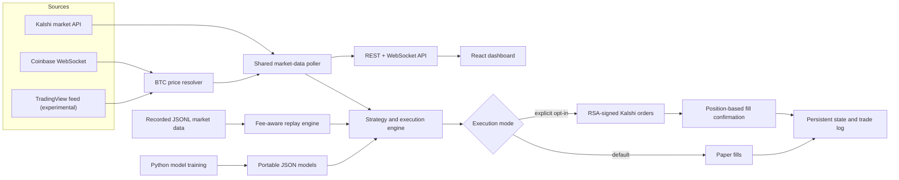

# Kalshi BTC Trading Engine

[](https://github.com/karma659/kalshi-btc-trading-engine/actions/workflows/ci.yml)
[](https://nodejs.org/)
[](#safety-model)

A real-time event-contract research and execution system for Kalshi's 15-minute BTC markets. It combines a shared market-data pipeline, a WebSocket dashboard, fee-aware replay, paper execution, optional RSA-signed live orders, and Python-trained strategy experiments.

> **Status:** research software. It starts in paper mode, does not guarantee profitability, and should not be exposed directly to the public internet.


_Paper-mode dashboard example. Historical values in the screenshot are illustrative and are not a verified performance claim._

## Why this project

Short-duration event markets compress ingestion, decision-making, execution, and reconciliation into a small time window. This project treats that as a systems problem:

- one shared poller feeds the engine and dashboard instead of duplicating external requests;
- live prices arrive over WebSocket, with explicit source selection and no silent source substitution;
- orders are not treated as filled until positions confirm the change;
- paper execution is the default and live execution requires an explicit environment opt-in;
- replay uses the same strategy modules and a simulated clock to reduce live/backtest drift;
- fees, spread, settlement, persistent state, and failure states are modeled explicitly.

## System at a glance



See [Architecture](docs/ARCHITECTURE.md) for component boundaries and failure behavior.
The local control surface is documented in [API Reference](docs/API.md).

## Core capabilities

### Real-time data plane

- Dynamically resolves the current `KXBTC15M` event.
- Normalizes Kalshi contract quotes for the dashboard and engine.
- Supports Coinbase WebSocket, an experimental TradingView feed, or explicit REST pricing.
- Pushes browser updates over WebSocket while serving state and controls over REST.
- Backs off external polling after failures and preserves the last known-good display value.

### Execution and reconciliation

- Defaults to paper mode even when the application is running normally.
- Requires both credentials and `ALLOW_LIVE_MODE=true` before live mode can be selected.
- Signs authenticated requests with RSA-PSS.
- Uses immediate-or-cancel orders and verifies fills against account positions.
- Refuses to issue a live close when current holdings cannot be confirmed.
- Cancels unfilled remainders and marks ambiguous closes for manual review.
- Persists configuration, realized results, and strategy state across restarts.

### Research workflow

- Replays recorded order books through the same strategy interface used by the runtime.
- Replaces wall-clock time with a deterministic simulated clock during replay.
- Reports gross P&L, modeled fees, net P&L, win rate, and per-trade results.
- Includes experimental JavaScript strategies and Python training scripts that export portable JSON models.
- Keeps generated datasets, credentials, runtime state, and logs out of version control.

## Quick start

### Prerequisites

- Node.js 18 or newer (Node.js 20+ recommended)
- npm
- Python 3.10+ only for the ML training scripts

### Run locally in demo/paper mode

```bash
git clone https://github.com/karma659/kalshi-btc-trading-engine.git
cd kalshi-btc-trading-engine/backend
npm ci
cp .env.example .env
npm start
```

Open [http://127.0.0.1:4000](http://127.0.0.1:4000). Credentials are not required for market data, the dashboard, or paper execution.

The service binds to `127.0.0.1` by default. Use `HOST=0.0.0.0` only inside a controlled container or trusted network.

### Run with Docker

```bash
docker compose up --build
```

The Compose configuration exposes the dashboard only on the local loopback interface and leaves live mode disabled.

## Safety model

There are three separate gates between a fresh clone and a live order:

1. The default runtime configuration is `paper`.
2. Live mode cannot be selected unless `ALLOW_LIVE_MODE=true`.
3. The execution adapter still requires a valid Kalshi API key and readable RSA private key.

To deliberately enable live mode:

```bash
cd backend
cp .env.example .env
```

Then edit `.env`:

```dotenv
ALLOW_LIVE_MODE=true
KALSHI_API_KEY_ID=your-key-id
KALSHI_PRIVATE_KEY_PATH=/absolute/path/outside-the-repository/kalshi-private-key.pem
```

Restart the service, verify the account and limits, run in paper mode first, and only then use the dashboard toggle. Never commit `.env`, private keys, generated state, or account data.

Read [Risk and Safety](docs/RISK_AND_SAFETY.md) before connecting an account.

## Configuration

The most important runtime settings are:

| Variable | Default | Purpose |
| --- | --- | --- |
| `HOST` | `127.0.0.1` | Network interface for the HTTP/WebSocket server |
| `PORT` | `4000` | Dashboard and API port |
| `BTC_SOURCE` | `websocket` | `websocket`, `tradingview`, or `rest` |
| `ALLOW_LIVE_MODE` | `false` | Required before the engine may enter live mode |
| `KALSHI_API_KEY_ID` | unset | Kalshi API key identifier |
| `KALSHI_PRIVATE_KEY_PATH` | `./kalshi-private-key.pem` | Path resolved from `backend/` |
| `V13_TARGET_BET` | `1.80` | Paper learner target allocation |
| `V13_POLL_MS` | `2000` | Paper learner polling interval |
| `V13_RETRAIN_INTERVAL_MS` | 24 hours | Automatic paper-model retraining interval |

Additional strategy-specific research variables are documented beside their defaults in `backend/strategy*.js`.

Runtime position sizing and exit thresholds are persisted in `backend/past_trades/bot-config.json`, which is generated automatically and ignored by Git.

## Backtesting

Collect public historical snapshots:

```bash
cd backend
DAYS=7 node fetch-history-15m.js
```

Replay one strategy:

```bash
ONLY=V1 node backtester.js
```

Replay selected strategies and print individual trades:

```bash
ONLY=V7,V10 TRADES=V7 node backtester.js
```

Override replay configuration without changing source:

```bash
TARGET=5.50 TP=2.00 SL=-2.50 NEAR_STRIKE=35 node backtester.js
```

The default dataset is `backend/past_trades/real_data_15m.jsonl`. Generated market data is intentionally excluded from Git because it can be large and may contain account-adjacent runtime context.

## ML experiments

Install the optional Python dependencies:

```bash
cd backend
python3 -m venv .venv-ml
source .venv-ml/bin/activate
python -m pip install -r requirements-ml.txt
```

The training and retraining scripts expect recorded JSONL data under `backend/past_trades/`. The exported model is plain JSON so JavaScript strategies can run inference without embedding a Python service in the live path.

## Validation

```bash
cd backend
npm ci
npm run validate
python3 -m compileall -q .
```

The CI workflow runs JavaScript syntax checks, deterministic unit tests, and Python syntax compilation on every push and pull request.

## Repository map

```text
.
├── backend/
│   ├── index.js                 # shared poller, API, WebSocket server
│   ├── bot.js                   # mode, execution, reconciliation, persistence
│   ├── backtester.js            # deterministic fee-aware replay
│   ├── strategy*.js             # production and research strategy modules
│   ├── train-*.py               # offline model training
│   ├── *-model.json             # portable trained models
│   ├── scripts/                 # repository validation helpers
│   └── test/                    # deterministic unit tests
├── frontend/                    # dashboard served by the backend
├── pine/                        # TradingView research script
├── docs/                        # architecture and operational safety
├── Dockerfile
└── compose.yaml
```

## Current scope and limitations

- `V1 (Volatility Scalping)` is the only strategy wired into the default engine process.
- Other strategies are retained for controlled replay or paper research and are not evidence of profitability.
- TradingView support relies on an undocumented protocol and is best-effort.
- This repository does not include a hosted multi-user control plane, authentication for dashboard routes, or production secrets management.
- The service is designed for local, single-operator use. Place it behind authentication and TLS before any remote deployment.
- Fee schedules and exchange APIs can change. The fee module is a model, not a billing oracle.
- Tests cover deterministic core behavior; exchange integration still requires paper-mode verification.

## Contributing and security

- Read [CONTRIBUTING.md](CONTRIBUTING.md) before opening a pull request.
- Report sensitive issues using the process in [SECURITY.md](SECURITY.md).
- High-risk changes to execution, authentication, reconciliation, fee calculation, or mode handling require new tests and paper-mode evidence.

## License

Copyright (c) 2026 Akash Karmakar. No open-source license is currently granted. Please contact the maintainer before reusing or redistributing the code.

## Disclaimer

This project is for engineering and research purposes only. It is not financial advice, does not promise returns, and may lose money. You are responsible for reviewing exchange rules, fees, tax consequences, credentials, limits, and every live-trading decision.
