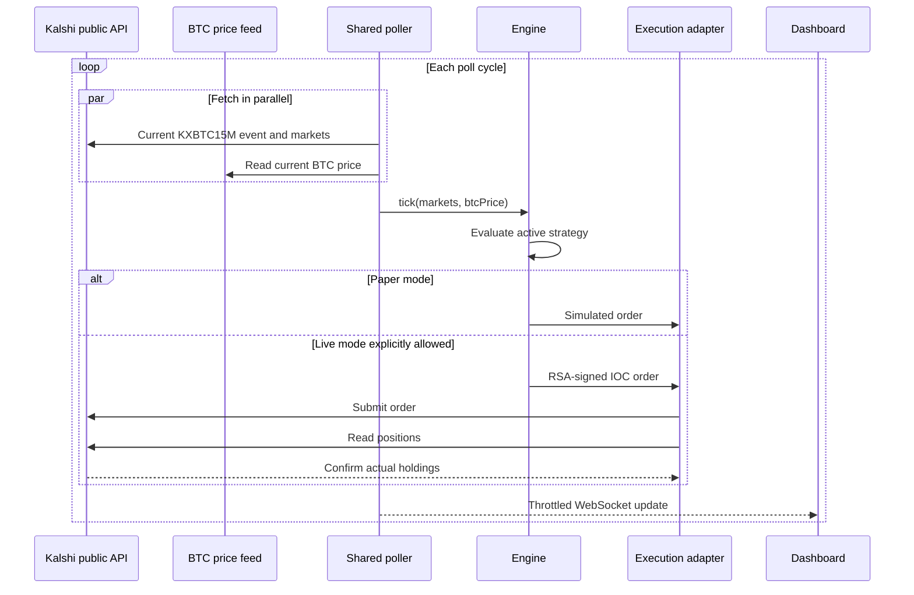
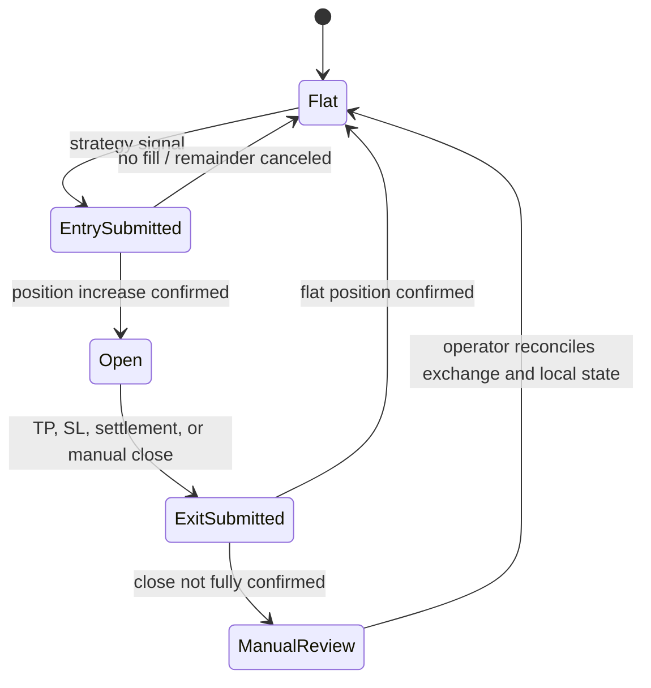

# Architecture

## Goals

The system is designed around four goals:

1. Keep one authoritative stream of market data.
2. Make paper execution the normal operating mode.
3. Reconcile live actions against exchange state instead of trusting local assumptions.
4. Reuse strategy code between runtime execution and historical replay.

It is a local, single-operator research system rather than a hosted multi-tenant trading service.

## Component boundaries

| Component | Responsibility | Important boundary |
| --- | --- | --- |
| `backend/index.js` | Market discovery, quote ingestion, BTC price selection, HTTP/WebSocket serving | Owns external public-data polling |
| `backend/bot.js` | Strategy lifecycle, paper/live mode, signing, order placement, fill confirmation, persistence | Owns all authenticated exchange actions |
| `backend/strategy*.js` | Pure or stateful entry/exit decisions | Must not place orders directly |
| `backend/backtester.js` | Recorded-data replay, simulated clock, fee accounting, result summaries | Must not mutate live learning state during evaluation |
| `backend/train-*.py` | Offline feature construction and model fitting | Writes portable JSON, not live orders |
| `frontend/` | Local operator dashboard | Calls the backend; never holds exchange credentials |

## Runtime data flow

The dashboard and engine use the same normalized market snapshot. This avoids a class of inconsistencies where the operator sees one price while a second poller trades on another.

## Execution state machine

Key invariants:

- An accepted order is not considered a fill.
- A live exit is not sent unless current holdings are readable.
- An unconfirmed close is not retried indefinitely.
- Runtime state cannot make live mode possible unless the process was started with `ALLOW_LIVE_MODE=true`.

## Persistence

Runtime files live under `backend/past_trades/`:

- `bot-config.json`: mode and operator-tunable thresholds;
- `bot-state.json`: realized history and strategy state;
- `trades.txt`: successful trade events;
- `*.jsonl`: recorded market data and learner observations.

These files are deliberately ignored by Git. They are local operational data, can become large, and may reveal account behavior.

## Backtesting architecture

The replay engine:

1. Reads newline-delimited market snapshots.
2. Replaces `Date` with a simulated clock.
3. Calls the same `chooseEntry`, `recordPrice`, `chooseExit`, and lifecycle hooks used by strategies.
4. Models entry fees and pre-settlement exit fees.
5. Resolves held positions from the last observed settlement book.
6. Reports gross, fees, and net results separately.

This reduces, but does not eliminate, simulation-to-live differences. Queue position, latency, partial liquidity, rejected orders, and fee schedule changes still require separate analysis.

## ML model boundary

Python scripts train tree-based models from recorded data and serialize a compact JSON representation. JavaScript strategy modules load that artifact for inference. This keeps Python and training dependencies outside the live event loop while preserving an inspectable deployment artifact.

## Failure behavior

| Failure | Behavior |
| --- | --- |
| Kalshi public API error | Polling interval backs off up to its configured ceiling |
| BTC WebSocket stale | No silent REST substitution; last known display value is retained |
| Missing credentials | Demo/paper execution only |
| Live mode not explicitly allowed | Mode resolves to paper |
| Order accepted but holding unchanged | Unfilled remainder is canceled |
| Holdings endpoint unreadable during close | Exit is refused rather than guessed |
| Partial or ambiguous close | Position enters manual-review state |
| State/config file unreadable | Engine keeps safe in-memory defaults and reports the error |

## Deployment boundary

The default server binds to `127.0.0.1`. Dashboard control routes are not authenticated, so remote deployment requires an authenticated reverse proxy, TLS, network restrictions, and a separate secrets-management decision. The included Compose file also binds the published port to the host loopback interface.
